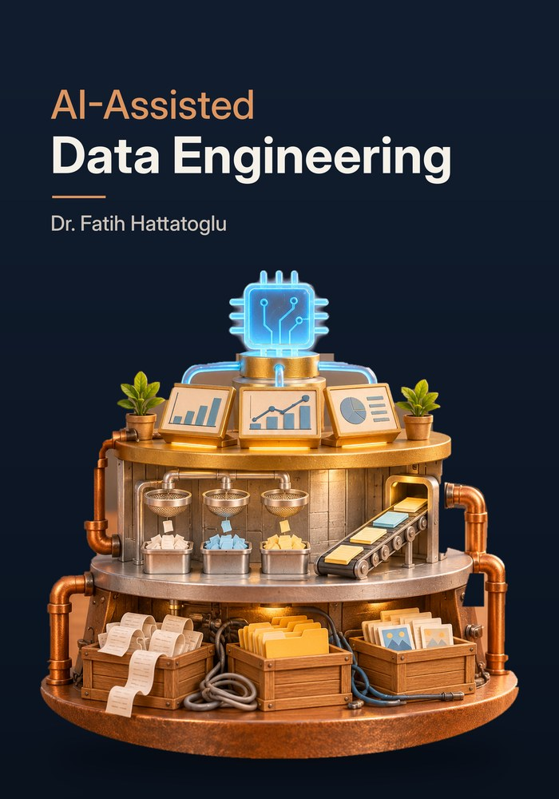

# AI-Assisted Data Engineering — meridian-data-book

Code and data repository of the book *AI-Assisted Data Engineering* by Dr. Fatih Hattatoglu: every
code block of the book, 32 synthetic data sets, the scripts, prompts and templates.

<p align="center">
  
</p>

## Get the book

*AI-Assisted Data Engineering: Build a Modern Data Platform by AI* is available on Amazon:

- **Paperback** (full color, 7 × 10 in, 555 pages): [amazon.com/dp/B0HS7S1H8Q](https://www.amazon.com/dp/B0HS7S1H8Q)
- **Kindle eBook**: [amazon.com/dp/B0HS6Q65P2](https://www.amazon.com/dp/B0HS6Q65P2)

> **Synthetic data notice:** All datasets in this repository were synthetically generated with
> `data/generate_data.py`. Meridian Market and Bazaarly are fictional companies. Names, email
> addresses, phone numbers, addresses and transactions in the data do not belong to any real person
> or company. Any resemblance to real persons or organizations is coincidental.

## Quick start (free path, DuckDB)

```bash
git clone https://github.com/fhattat/meridian-data-book && cd meridian-data-book
pip install -r requirements.txt
python data/generate_data.py --size small --seed 2027 --out data/raw   # or: make data (the data is already in the repo)
export PYTHONPATH=.                                                     # Windows PowerShell: $env:PYTHONPATH="."
python run_pipeline.py --env local --size small                         # or: make all
```

The last line should read `[reconcile] status: pass`: net sales in gold match
`data/raw/control_totals.json` to the cent in all 60 company-months. The same seed always produces
exactly the same files.

## What is in the repository?

| Folder / file | Contents |
|---|---|
| `ch01_…` – `ch20_…` | Chapter folders (QR-01 … QR-20). Each has a `README.md`, `BOOK_CODE.md` (every code block of the chapter under the book's section headings) and the runnable scripts |
| `data/generate_data.py`, `data/raw/` | The data generator and the small data set (Appendix F: MM01–MM11, BZ01–BZ13, OP01–OP08), `control_totals.json`, `answer_key.json` |
| `ref/` | Mapping and reference files: channel codes, test records, product mapping, state aliases, `source_guide.yaml` |
| `contracts/`, `metrics/`, `governance/`, `products/`, `glossary.yaml` | Data contracts, metric definitions, ownership, data product card, business glossary |
| `lib/` | Shared library: `io.py`, `reconcile.py`, `schema_gate.py`, `llm.py`, `log.py` |
| `prompts/` | Appendix E: the prompt and skill library (E.0–E.21), one file each (QR-Appendix E) |
| `runbooks/`, `jobs/`, `databricks.yml`, `pipelines.yaml` | Runbooks, Databricks jobs and Asset Bundle, config-driven pipeline |
| `appendices/` | Code of Appendices D and F |
| `tests/` | Tests of the library, the data set and the pipeline; Appendix C interview SQL exercises |
| `REFERENCES.md` | Appendix G bibliography with clickable links (QR-Appendix G) |
| `CLAUDE.md`, `RULES.md`, `corrections.md`, `CODEOWNERS` | Project context, rules and error memory for coding with AI (Chapters 2.3 and 17.5) |

`make` targets: `data`, `sample`, `profile`, `bronze`, `silver`, `quality`, `gold`, `checks`, `all`,
`serve`, `rag`, `metadata`, `rls`, `review`, `logs`, `test`.

## Notes

- **Environments:** every script takes `--env local|databricks`. `local` writes to `data/meridian.duckdb`
  and `data/layers/<layer>/<table>.parquet`. For Databricks see Chapters 3.1 and 18.2.
- **"Now":** the data ends on 30 June 2027. Freshness and future-date rules use `MERIDIAN_AS_OF`
  (default `2027-07-01 07:00:00`), not your computer's clock.
- **AI calls:** the book leaves `ask_llm()` in `lib/llm.py` empty on purpose; you connect your own
  assistant. Optional ready-made adapter: `pip install anthropic`, `MERIDIAN_LLM=anthropic`. Scripts that
  need a model (agents, the text-to-SQL experiment) stop with a clear message until it is connected.
- **Agent tool names** (`profile`, `ingest`, `clean`, `quality`, `modeling`, `incident`, `catalog`,
  `review`, `search_docs`) are the identifiers used in the book's code.
- **Differences from the book:** scripts printed as "(shortened)" in the book are complete here. Lines
  added for the repository are marked with a `repo:` comment.
- **CI:** on every push GitHub Actions runs the whole pipeline and the tests (`.github/workflows/ci.yml`).

## License

Code: MIT (`LICENSE`). Data: CC BY 4.0 (`LICENSE-DATA.md`). The book text is not part of this repository.
