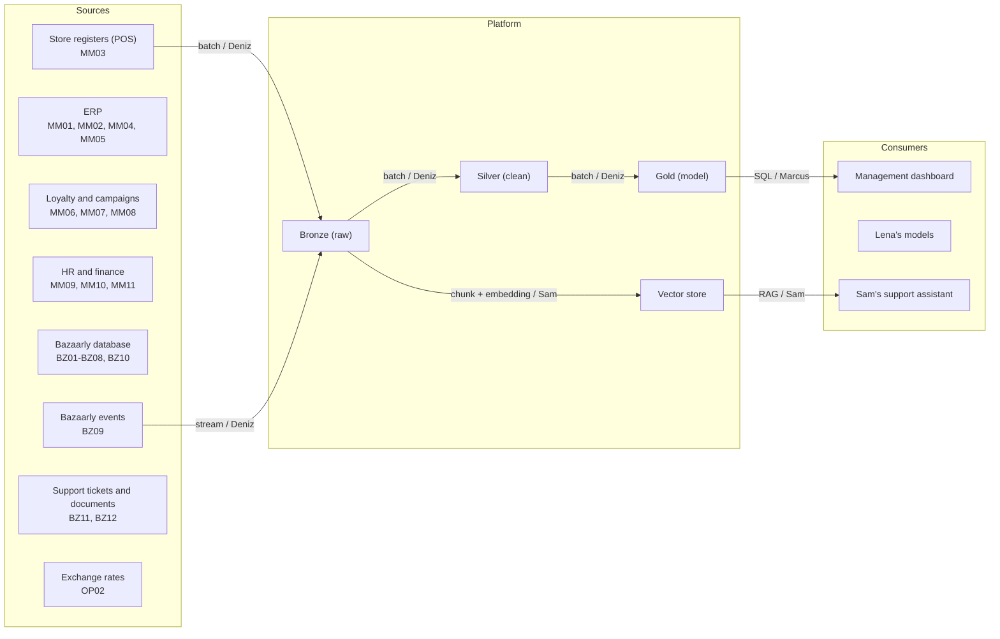

# Bölüm 5 — Mimariyi tasarlamak ve çizmek

## Code from the book

Every code block of this chapter, in book order, under the book's section headings (Turkish, as printed).
Runnable files are in this folder; for scripts printed as "(shortened)" the full version is the file here.
Bu dosya bölümdeki bütün kod bloklarını kitaptaki sırasıyla ve alt bölüm başlıklarıyla verir.

### 5.5 Mimari karar kaydı (ADR)

> Şablon ve Meridian’dan bir örnek:

**Code 5.1**

```markdown
# ADR-003: POS data arrives as a daily batch; Bazaarly events are ingested as a stream and processed daily

Status: Accepted
Date: 2027-02-15
Decision owner: Priya (data architect)
Consulted: Deniz (data engineering), Marcus (finance), Sam (AI), Bazaarly product team

## Context
- Store sales arrive every night as a single CSV file.
- Bazaarly web and app events are produced continuously (JSON).
- No business unit gave a concrete answer to "What would you do differently if it were 9:05?"
- The support assistant must see order status with at most one hour of delay.

## Options
1. Everything as a daily batch.
2. End-to-end streaming for events (ingestion + processing + serving).
3. Events are ingested as a stream and written to the lake, processed once a day; order status as an hourly micro-batch.

## Decision
Option 3.

## Rationale
- No event loss, because ingestion never stops.
- No always-on processing infrastructure; lower cost and complexity.
- If a real-time need appears later, a new branch can be fed from the same stream.

## Cost
- Event data in reports is at most one day old.
- Late-arriving events need a next-day correction (Chapter 8).

## When do we revisit?
- When a business unit shows, with a concrete example, that an hour of delay loses money.
```

### 5.6 Uygulama: AI ile mimari danışmanlık ve kodla çizilen diyagram

> Adım 1: Mimariyi metne dökün. Dosyada üç liste ve bir ok listesi var: kaynaklar, platform katmanları, tüketiciler ve aralarındaki akışlar. Kaynakların yanındaki MM, BZ ve OP kodları kitabın veri seti kataloğundaki kimlikler (QR’daki depo). Log, sorgu…

**Code 5.2**

```yaml
# architecture.yaml
name: meridian-data-platform
sources:
  - {id: pos, name: "Store registers (POS)", datasets: [MM03]}
  - {id: erp, name: "ERP", datasets: [MM01, MM02, MM04, MM05]}
  - {id: crm, name: "Loyalty and campaigns", datasets: [MM06, MM07, MM08]}
  - {id: hr_fin, name: "HR and finance", datasets: [MM09, MM10, MM11]}
  - {id: bz_db, name: "Bazaarly database", datasets: [BZ01-BZ08, BZ10]}
  - {id: bz_events, name: "Bazaarly events", datasets: [BZ09]}
  - {id: bz_docs, name: "Support tickets and documents", datasets: [BZ11, BZ12]}
  - {id: fx, name: "Exchange rates", datasets: [OP02]}
layers:
  - {id: bronze, name: "Bronze (raw)"}
  - {id: silver, name: "Silver (clean)"}
  - {id: gold, name: "Gold (model)"}
  - {id: vector, name: "Vector store"}
consumers:
  - {id: dashboard, name: "Management dashboard"}
  - {id: models, name: "Lena's models"}
  - {id: assistant, name: "Sam's support assistant"}
flows:
  - {from: pos, to: bronze, mode: batch, schedule: "daily 02:00 ET", owner: Deniz}
  - {from: erp, to: bronze, mode: batch, schedule: "daily 02:00 ET", owner: Deniz}
  - {from: crm, to: bronze, mode: batch, schedule: "daily 02:00 ET", owner: Deniz}
  - {from: hr_fin, to: bronze, mode: batch, schedule: "monthly", owner: Deniz}
  - {from: bz_db, to: bronze, mode: micro-batch, schedule: "hourly", owner: Deniz}
  - {from: bz_events, to: bronze, mode: stream, schedule: "continuous", owner: Deniz}
  - {from: bz_docs, to: bronze, mode: batch, owner: Sam}
  - {from: fx, to: bronze, mode: batch, schedule: "business days", owner: Deniz}
  - {from: bronze, to: silver, mode: batch, schedule: "daily, after bronze", owner: Deniz}
  - {from: silver, to: gold, mode: batch, schedule: "daily, after silver", owner: Deniz}
  - {from: bronze, to: vector, mode: "chunk + embedding", schedule: "on change", owner: Sam}
  - {from: gold, to: dashboard, mode: SQL, schedule: "every morning by 07:30 ET", owner: Marcus}
  - {from: silver, to: models, mode: Python, schedule: "daily", owner: Lena}
  - {from: gold, to: models, mode: Python, schedule: "daily", owner: Lena}
  - {from: vector, to: assistant, mode: RAG, schedule: "on query", owner: Sam}
  - {from: gold, to: assistant, mode: SQL, schedule: "on query", owner: Sam}
```

> Adım 2: Metni diyagrama çevirin. Script, dosyayı okuyup Mermaid söz dizimiyle bir akış diyagramı yazıyor. Mermaid, metinden diyagram çizen açık kaynaklı bir dil; GitHub, birçok wiki ve not aracı onu doğrudan gösterir. Script ayrıca 5.4’teki “okları say”…

**Code 5.3**

```python
"""Reads architecture.yaml and produces a Mermaid flowchart.
Usage: python architecture_to_mermaid.py architecture.yaml > architecture.mmd
Requires: pip install pyyaml
"""
import sys
import yaml

GROUPS = [("sources", "Sources"), ("layers", "Platform"), ("consumers", "Consumers")]
REQUIRED = ("mode", "schedule", "owner")  # every arrow's contract must have these


def to_mermaid(arch: dict) -> str:
    lines = ["flowchart LR"]
    known = set()
    for key, title in GROUPS:
        lines.append(f'  subgraph {key}["{title}"]')
        for item in arch.get(key, []):
            known.add(item["id"])
            label = item["name"]
            if item.get("datasets"):
                label += "<br/>" + ", ".join(item["datasets"])
            lines.append(f'    {item["id"]}["{label}"]')
        lines.append("  end")
    for flow in arch.get("flows", []):
        for end in (flow["from"], flow["to"]):
            if end not in known:
                raise ValueError(f"Undefined node: {end}")
        note = flow.get("mode", "")
        if flow.get("owner"):
            note = f"{note} / {flow['owner']}" if note else flow["owner"]
        arrow = f'-- "{note}" -->' if note else "-->"
        lines.append(f'  {flow["from"]} {arrow} {flow["to"]}')
    return "\n".join(lines)


def missing_contracts(arch: dict) -> list[str]:
    problems = []
    for flow in arch.get("flows", []):
        missing = [k for k in REQUIRED if not flow.get(k)]
        if missing:
            problems.append(f"{flow['from']} -> {flow['to']}: missing {', '.join(missing)}")
    return problems


if __name__ == "__main__":
    path = sys.argv[1] if len(sys.argv) > 1 else "architecture.yaml"
    with open(path, encoding="utf-8") as f:
        arch = yaml.safe_load(f)
    print(to_mermaid(arch))
    for problem in missing_contracts(arch):
        print(f"WARNING: {problem}", file=sys.stderr)
```

> Script çalışınca ekrana tek bir uyarı düşüyor: WARNING: bz_docs -> bronze: missing schedule. Gerçekten de destek dokümanlarının ne zaman geleceğini henüz kimse söylemedi. Priya bu soruyu Bazaarly destek ekibine iletiyor. Diyagram dosyasının ilk satırları…

**Code 5.4**


