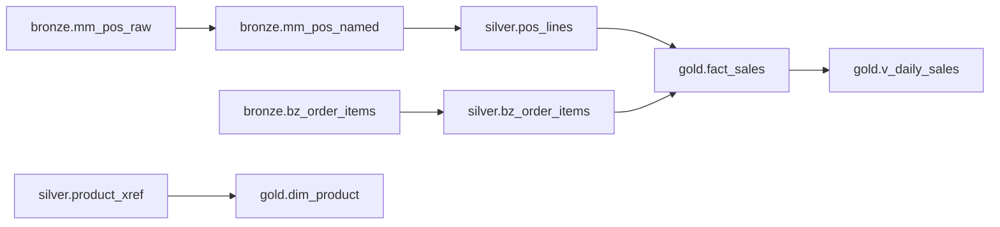

# Chapter 14 — Metadata, catalog, lineage and security

## Code from the book

Every code block of this chapter, in book order, under the book's section headings.
Runnable files are in this folder; for scripts printed as "(shortened)" in the book, the full version is the file here.

### 14.2 Producing metadata: technical facts from the data, descriptions from documents, unknowns empty

**Code 14.1**

```python
"""extract_metadata.py: builds table metadata from the data and the source guide."""
import argparse, json, re
from datetime import datetime, timezone
from pathlib import Path
import duckdb, yaml

DB = "data/meridian.duckdb"
GUIDE = Path("ref/source_guide.yaml")
OWNERS = Path("governance/owners.yaml")
OUT = Path("metadata")

PII_RULES = [
    ("direct", r"(^|_)(email|phone|first_name|last_name|full_name|street|address)(_|$)"),
    ("indirect", r"(^|_)(birth|zip|ip|device)(_|$)"),
    ("free_text", r"(^|_)(body|notes|subject|message)(_|$)"),
]

def pii_label(column):
    for label, pattern in PII_RULES:
        if re.search(pattern, column.lower()):
            return label
    return None

def load_yaml(path):
    if not path.exists():
        return {}
    return yaml.safe_load(path.read_text(encoding="utf-8")) or {}

def describe(con, schema, table, guide, owners):
    stats = con.execute(f"SUMMARIZE {schema}.{table}").fetchall()
    names = [d[0] for d in con.description]
    row_count = con.execute(f"SELECT COUNT(*) FROM {schema}.{table}").fetchone()[0]
    g = guide.get("tables", {}).get(table, {})
    columns = []
    for raw in stats:
        s = dict(zip(names, raw))
        col = s["column_name"]
        gc = g.get("columns", {}).get(col, {})
        label = pii_label(col)
        samples = None
        if label is None:  # no sample values for personal data
            samples = [str(r[0]) for r in con.execute(
                f'SELECT DISTINCT "{col}" FROM {schema}.{table} WHERE "{col}" IS NOT NULL LIMIT 3'
            ).fetchall()]
        columns.append({
            "name": col,
            "type": s["column_type"],
            "null_pct": round(float(s["null_percentage"] or 0), 2),
            "approx_distinct": int(s["approx_unique"] or 0),
            "sample_values": samples,
            "pii": label,
            "description": gc.get("description"),          # stays None if missing
            "description_source": "source_guide" if gc.get("description") else None,
            "allowed_values": gc.get("allowed_values"),
        })
    o = owners.get(f"{schema}.{table}", {})
    return {
        "table": f"{schema}.{table}",
        "row_count": row_count,
        "description": g.get("description"),
        "description_source": "source_guide" if g.get("description") else None,
        "domain": o.get("domain"),
        "owner": o.get("owner"),
        "steward": o.get("steward"),
        "extracted_at": datetime.now(timezone.utc).isoformat(timespec="seconds"),
        "columns": columns,
    }
```

**Code 14.2**

```yaml
table: silver.customers
row_count: 29400
description: null
description_source: null
domain: customer
owner: CRM and loyalty director
steward: CRM analyst
columns:
  - name: customer_type
    type: VARCHAR
    null_pct: 0.0
    approx_distinct: 3
    sample_values: [member, user, account]
    pii: null
    description: null
    description_source: null
  - name: email_norm
    type: VARCHAR
    null_pct: 0.4
    approx_distinct: 29100
    sample_values: null
    pii: direct
    description: null
    description_source: null
```

### 14.3 Catalog and lineage: Unity Catalog and open alternatives

**Code 14.3**

```sql
COMMENT ON TABLE meridian.silver.customers IS
  'One row per source customer record (member, user or account). See glossary term: customer.';

ALTER TABLE meridian.silver.customers ALTER COLUMN email_norm
  COMMENT 'Lower-cased, trimmed e-mail; used to match the same person across companies.';

ALTER TABLE meridian.silver.customers SET TAGS ('domain' = 'customer', 'owner' = 'crm_director');
ALTER TABLE meridian.silver.customers ALTER COLUMN email_norm SET TAGS ('pii' = 'direct');
```

**Code 14.4**

```python
from html import escape

SQL_DIRS = [Path("ch09_medallion/sql/silver/duckdb"), Path("ch11_modeling/sql/gold")]
CREATE = re.compile(r"CREATE\s+OR\s+REPLACE\s+(?:TABLE|VIEW)\s+([\w.]+)", re.I)
REF = re.compile(r"\b(?:FROM|JOIN)\s+((?:bronze|silver|gold|ref)\.\w+)", re.I)

def lineage_from_sql():
    """Extracts (source, target) edges from the SQL files."""
    edges = set()
    for d in SQL_DIRS:
        for f in sorted(d.glob("*.sql")):
            parts = CREATE.split(f.read_text(encoding="utf-8"))
            for target, body in zip(parts[1::2], parts[2::2]):
                for src in REF.findall(body):
                    if src.lower() != target.lower():
                        edges.add((src.lower(), target.lower()))
    return sorted(edges)

def downstream(edges, node):
    """Impact analysis: every table fed by node."""
    found, todo = set(), [node]
    while todo:
        cur = todo.pop()
        for src, dst in edges:
            if src == cur and dst not in found:
                found.add(dst)
                todo.append(dst)
    return sorted(found)

def to_mermaid(edges, keep=None):
    lines = ["flowchart LR"]
    for src, dst in edges:
        if keep and not ({src, dst} & keep):
            continue
        a, b = src.replace(".", "_"), dst.replace(".", "_")
        lines.append(f'  {a}["{src}"] --> {b}["{dst}"]')
    return "\n".join(lines)

def catalog_html(metas):
    rows = []
    for m in metas:
        missing = sum(1 for c in m["columns"] if not c["description"])
        rows.append(f"<tr><td>{escape(m['table'])}</td><td>{escape(str(m.get('owner') or '-'))}</td>"
                    f"<td>{m['row_count']}</td><td>{len(m['columns'])}</td><td>{missing}</td></tr>")
    return ("<html><body><h1>Meridian data catalog</h1><table border='1'>"
            "<tr><th>Table</th><th>Owner</th><th>Rows</th><th>Columns</th><th>Missing descriptions</th></tr>"
            + "".join(rows) + "</table></body></html>")
```

**Code 14.5**



### 14.4 Data dictionary versus business glossary

**Code 14.6**

```yaml
terms:
  customer:
    definition: >
      A person or a business that bought from Meridian Market or Bazaarly.
      One customer can have several source records: a loyalty member (Meridian),
      a marketplace user (Bazaarly) and/or a wholesale account (Meridian finance).
    synonyms: [member, user, account]
    owner: CRM and loyalty director
    steward: CRM analyst
    columns: [silver.customers.customer_id, silver.customer_xref.email_norm, gold.dim_customer.customer_id]
  active_customer:
    definition: >
      A distinct customer (after matching records by normalized e-mail) with at least
      one non-test, non-cancelled sale in the last 12 months.
    calculation: >
      COUNT(DISTINCT silver.customer_xref.email_norm) over customers with at least one
      gold.fact_sales row (joined via gold.dim_customer.customer_key) in the last 365 days
    excludes: [test records, cancelled orders, wholesale accounts]
    owner: CRM and loyalty director
    approved_on: 2027-06-15
  net_sales:
    definition: >
      Sales amount in USD after discounts and returns, excluding test records,
      cancelled orders, shipping and tax. Order-day FX rate; weekends use the last business day.
    calculation: "SUM(amount_usd) FROM gold.fact_sales"
    owner: Commercial director
```

### 14.5 Security: least privilege, RBAC, masking, privacy law

**Code 14.7**

```sql
GRANT USE CATALOG ON CATALOG meridian TO `analysts`;
GRANT USE SCHEMA, SELECT ON SCHEMA meridian.gold TO `analysts`;
GRANT USE SCHEMA ON SCHEMA meridian.gold TO `ai_assistant_sp`;
GRANT SELECT ON TABLE meridian.gold.rag_chunks TO `ai_assistant_sp`;
```

**Code 14.8**

```sql
CREATE OR REPLACE FUNCTION meridian.silver.mask_email(email STRING)
  RETURN CASE WHEN is_account_group_member('pii_readers') THEN email
              ELSE regexp_replace(email, '^[^@]+', '***') END;

ALTER TABLE meridian.silver.customers ALTER COLUMN email_norm SET MASK meridian.silver.mask_email;
```

**Code 14.9**

```sql
CREATE OR REPLACE VIEW gold.v_customers_masked AS
SELECT customer_id,
       customer_type,
       regexp_replace(email_norm, '^[^@]+', '***') AS email_masked,
       state_code,
       region
FROM silver.customers
WHERE NOT is_test;
```

**Code 14.10**

```python
"""rls_test.py: verifies that the secure view shows each user exactly the expected regions."""
import duckdb

DB = "data/meridian.duckdb"

def run(env="local"):
    con = duckdb.connect(DB, read_only=True)
    users = con.execute("SELECT email, region FROM silver.security_user_region").fetchall()
    all_regions = {r[0] for r in con.execute("SELECT DISTINCT region FROM gold.dim_store").fetchall()}
    failures = []
    for email, region in users:
        con.execute(f"SET VARIABLE app_user = '{email}'")  # synthetic, safe emails
        seen = {r[0] for r in con.execute(
            "SELECT DISTINCT region FROM gold.v_fact_sales_secure").fetchall()}
        expected = all_regions if region == "ALL" else {region}
        if seen != expected:
            failures.append({"user": email, "expected": sorted(expected), "seen": sorted(seen)})
    return {"users_tested": len(users), "failures": failures,
            "status": "pass" if not failures else "fail"}

if __name__ == "__main__":
    print(run())
```

### 14.6 Script → tool: extract_metadata.py → the catalog tool

**Code 14.11**

```python
def run(schema="silver", tables=None, env="local", out_dir="metadata"):
    if Path(out_dir).resolve() != OUT.resolve():
        raise PermissionError("the catalog tool writes only to the metadata/ folder")
    con = duckdb.connect(DB, read_only=True)          # read-only connection to the data
    guide, owners = load_yaml(GUIDE), load_yaml(OWNERS)
    if not tables:
        tables = [r[0] for r in con.execute(
            "SELECT table_name FROM information_schema.tables "
            "WHERE table_schema = ? ORDER BY 1", [schema]).fetchall()]
    OUT.mkdir(exist_ok=True)
    metas = []
    for t in tables:
        meta = describe(con, schema, t, guide, owners)
        (OUT / f"{schema}.{t}.yaml").write_text(
            yaml.safe_dump(meta, allow_unicode=True, sort_keys=False), encoding="utf-8")
        metas.append(meta)
    edges = lineage_from_sql()
    (OUT / "lineage.mmd").write_text(to_mermaid(edges), encoding="utf-8")
    (OUT / "catalog.html").write_text(catalog_html(metas), encoding="utf-8")
    return {
        "schema": schema,
        "tables": [{"table": m["table"],
                    "columns": len(m["columns"]),
                    "missing_descriptions": sum(1 for c in m["columns"] if not c["description"]),
                    "pii_columns": sum(1 for c in m["columns"] if c["pii"])} for m in metas],
        "lineage_edges": len(edges),
        "output_dir": str(OUT),
    }

if __name__ == "__main__":
    p = argparse.ArgumentParser()
    p.add_argument("--env", default="local", choices=["local", "databricks"])
    p.add_argument("--schema", default="silver")
    p.add_argument("--tables", nargs="*")
    a = p.parse_args()
    print(json.dumps(run(schema=a.schema, tables=a.tables, env=a.env), indent=2))
```

**Code 14.12**

```json
{
  "name": "catalog",
  "description": "Extracts technical metadata for the tables in a schema directly from the data, takes descriptions only from the source guide, and writes YAML files, a lineage diagram and a catalog page to the metadata/ folder. Never invents descriptions; unknown fields stay empty.",
  "input_schema": {
    "type": "object",
    "properties": {
      "schema": {"type": "string", "enum": ["bronze", "silver", "gold", "quality"]},
      "tables": {"type": "array", "items": {"type": "string"}, "description": "Optional list; all tables in the schema when omitted."},
      "env": {"type": "string", "enum": ["local", "databricks"], "default": "local"}
    },
    "required": ["schema"]
  }
}
```
