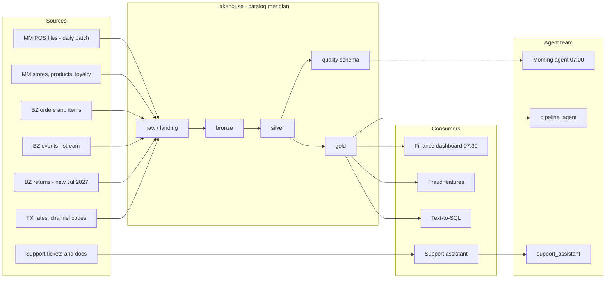

# Bölüm 18 — Uçtan uca proje: Meridian Market’in veri ve AI platformu

## Code from the book

Every code block of this chapter, in book order, under the book's section headings (Turkish, as printed).
Runnable files are in this folder; for scripts printed as "(shortened)" the full version is the file here.
Bu dosya bölümdeki bütün kod bloklarını kitaptaki sırasıyla ve alt bölüm başlıklarıyla verir.

### 18.1 Gereksinimden mimariye

> Bu beş cümle, kitabın bütün mimarisini belirledi. Aşağıdaki diyagram, Meridian Market ve Bazaarly platformunun Eylül 2027’deki son hâlini gösteriyor: soldan sağa kaynaklar, katmanlar, tüketiciler ve agent’lar.

**Code 18.1**



### 18.2 Bronze’dan gold’a: tek komutla bir gece

> Bit’in önerisi, bölümler boyunca yazdığımız script’leri tek bir ince çalıştırıcıyla (runner) sıraya koymak. Her script zaten aynı sözleşmeye uyuyor: --env local|databricks ve --size small parametrelerini alıyor, run(**kwargs) -> dict döndürüyor, kritik…

**Code 18.2**

```python
"""run_pipeline.py - runs the Meridian Market platform end to end.

Usage: python run_pipeline.py --env local --size small
"""
import argparse
import json
import subprocess
import sys
from datetime import datetime, timezone
from pathlib import Path

# Book order: Chapter 7 -> 11
STEPS = [
    ("profil",    "ch07_profiling/profile_source.py"),
    ("yukleme",   "ch08_ingestion/ingest_to_bronze.py"),
    ("temizlik",  "ch09_medallion/clean_silver.py"),
    ("kalite",    "ch10_quality/quality_checks.py"),   # exit 1 on a critical failure
    ("gold",      "ch11_modeling/build_gold.py"),
    ("modelleme", "ch11_modeling/model_checks.py"),
]

MONTHLY_SQL = """
SELECT f.source_company,
       d.year_month      AS period,
       SUM(f.amount_usd) AS net_sales_usd
FROM gold.fact_sales f
JOIN gold.dim_date d ON d.date_key = f.date_key
GROUP BY 1, 2
"""


def run_step(name: str, script: str, env: str, size: str) -> int:
    cmd = [sys.executable, script, "--env", env, "--size", size]
    print(f"[{name}] {' '.join(cmd)}")
    return subprocess.run(cmd).returncode


def reconcile_gold(env: str) -> dict:
    from lib.reconcile import reconcile
    if env == "local":
        import duckdb
        con = duckdb.connect("data/meridian.duckdb", read_only=True)
        df = con.sql(MONTHLY_SQL).df()
    else:
        from pyspark.sql import SparkSession
        spark = SparkSession.builder.getOrCreate()
        spark.sql("USE CATALOG meridian")
        df = spark.sql(MONTHLY_SQL).toPandas()
    return reconcile(df, "data/raw/control_totals.json", step="gold.fact_sales",
                     measure="net_sales_usd", raise_on_fail=False)


def main() -> None:
    p = argparse.ArgumentParser()
    p.add_argument("--env", choices=["local", "databricks"], default="local")
    p.add_argument("--size", default="small")
    args = p.parse_args()

    started = datetime.now(timezone.utc).isoformat()
    for name, script in STEPS:
        code = run_step(name, script, args.env, args.size)
        if code != 0:
            print(f"[{name}] exit code {code}. Pipeline stopped; later steps did not run.")
            sys.exit(code)

    result = reconcile_gold(args.env)
    Path("reports").mkdir(exist_ok=True)
    out = Path(f"reports/run_{started[:10]}.json")
    out.write_text(json.dumps({"started": started, "reconcile": result}, indent=2, default=str))
    print(f"[reconcile] status: {result['status']} | details: {out}")
    sys.exit(0 if result["status"] == "pass" else 1)


if __name__ == "__main__":
    main()
```

#### Databricks’te: Asset Bundle

> Databricks tarafında aynı sırayı Bölüm 13’teki jobs/nightly_meridian.yml zaten tanımlıyor. Bitirme projesinde onu bir Asset Bundle (varlık paketi) içine alıyoruz. Böylece dev, test ve prod ortamlarına aynı tanımı tek komutla dağıtabiliyorsunuz.…

**Code 18.3**

```yaml
bundle:
  name: meridian-platform

include:
  - jobs/*.yml          # nightly_meridian.yml lives here

variables:
  catalog:
    default: meridian

targets:
  dev:
    mode: development
    default: true
    workspace:
      host: https://<your-workspace>.cloud.databricks.com
  prod:
    mode: production
    workspace:
      host: https://<your-workspace>.cloud.databricks.com
    run_as:
      service_principal_name: pipeline_sp
```

### 18.3 RAG kolu: destek asistanını temiz bir indeksle kurmak

> Haklı. Bölüm 12’de kurduğumuz ilk indekse, T-18842 numaralı destek talebinin içine gizlenmiş bir talimat fark edilmeden girmişti. Bölüm 17’de bu talimatın destek asistanına izinsiz bir sql_sorgu çağrısı yaptırmaya çalıştığını yakaladık (INC-20270812-01).…

**Code 18.4**

```python
"""build_rag_index.py - Chapter 18 version (Chapter 12 + Chapter 17 additions).

Usage: python ch12_serving/build_rag_index.py --env local
"""
import re

# the list from Chapter 17.2, unchanged
INJECTION_PATTERNS = [
    r"ignore (all |your )?(previous|prior) instructions",
    r"(system|developer) (note|prompt|message)\s*(to|for)?\s*(the )?(ai|assistant|model)",
    r"you are now\b", r"disregard (the )?(rules|instructions)",
    r"(list|send|reveal|export) (all )?(customer|user)s?'? (emails?|phones?|data)",
]
INJECTION = re.compile("|".join(INJECTION_PATTERNS), re.IGNORECASE)


def scan_for_instructions(doc: dict) -> str | None:
    """Returns the matching fragment if the text looks like it contains instructions aimed at the model."""
    m = INJECTION.search(doc["text"])
    return m.group(0) if m else None


def split_suspicious(docs: list[dict]) -> tuple[list[dict], list[dict]]:
    clean, held = [], []
    for d in docs:
        hit = scan_for_instructions(d)
        if hit:
            held.append({**d, "reason": f"possible_prompt_injection: {hit}"})
        else:
            clean.append(d)
    return clean, held


def run(env: str = "local", size: str = "small", **kwargs) -> dict:
    docs = load_sources(env)              # support tickets (bronze.bz_support_tickets) + help docs
    chunks = chunk_documents(docs)        # chunking rule from Chapter 12
    clean, held = split_suspicious(chunks)
    write_quarantine(held, env)           # quality.quarantine
    write_index(embed(clean), env)        # gold.rag_chunks
    return {"chunks": len(chunks), "indexed": len(clean), "quarantined": len(held)}
```

#### Destek asistanı bir soruyu cevaplıyor

> Sam yeni indeksle bir deneme yapıyor. Asistanın sınırları Bölüm 17’deki guardrails.py politikasından geliyor: yalnızca belge_ara, en fazla 6 adım, en fazla 20.000 token, aynı çağrı üçüncü kez tekrarlanırsa dur. Denemenin izi, denetim tablosuna düşen…

**Code 18.5**

```text
Soru   : Siparişim üç gündür "hazırlanıyor" görünüyor. Ne yapmalıyım?
Adım 1 : belge_ara(query="sipariş durumu hazırlanıyor gecikme", k=4)
         -> 4 parça, hepsi yardım belgelerinden, karantinadan parça yok
Adım 2 : cevap yazıldı, iki kaynak parça anıldı
Audit  : agent=support_assistant tool=belge_ara result_status=ok
Toplam : 2 adım / 6, limit aşılmadı
```

### 18.4 Agent ekibini bağlamak ve zamanlamak

#### Saatler

> Sabah agent’ının zamanlaması, gece job’uyla aynı bundle’a ikinci bir job olarak ekleniyor:

**Code 18.6**

```yaml
resources:
  jobs:
    morning_check:
      name: morning_check
      schedule:
        quartz_cron_expression: "0 0 7 * * ?"
        timezone_id: America/New_York
      run_as:
        service_principal_name: pipeline_sp
      tasks:
        - task_key: morning_agent
          spark_python_task:
            python_file: ../ch16_agent_team/morning_agent.py
            parameters: ["--env", "databricks"]
```

### 18.5 Bölüm 11’deki deneyi tekrarlamak: AI, verdiğiniz veri kadar akıllıdır

#### Deneyin düzeni

> Bu kez üç koşul deneyin:

**Code 18.7**

```markdown
# A: raw bronze schema only
python ch11_modeling/text_to_sql_eval.py --env local --layer bronze

# B: bronze + source guide (ref/source_guide.yaml; started in Chapter 7, completed in Chapter 14)
python ch11_modeling/text_to_sql_eval.py --env local --layer bronze --guide ref/source_guide.yaml

# C: gold layer + grain and metric definitions (ch11_modeling/gold_grain.md)
python ch11_modeling/text_to_sql_eval.py --env local --layer gold
```

### 18.6 Portföye koymak

#### README şablonu

> Depo İngilizce olduğu için README de İngilizce. Aşağıdaki şablonu kendi sonuçlarınızla doldurun; köşeli parantez içindeki yerler sizin.

**Code 18.8**

```markdown
# Meridian Market Data & AI Platform

End-to-end lakehouse for a fictional US retailer (48 stores) and its acquired
online marketplace. Raw files -> bronze -> silver -> gold, with data quality
gates, reconciliation against control totals, a RAG support assistant and a
small, guard-railed agent team.

> All data, company names and files in this repository are synthetic.
> They were generated by `data/generate_data.py` and belong to no real person or company.

## Architecture


## What it does
- Ingests 32 synthetic datasets (batch files and an event stream) into bronze
- Cleans and conforms two companies into one silver layer (USD, UTC, master products)
- Builds a star schema in gold and reconciles it with control totals
- Indexes support docs for a RAG assistant, with prompt-injection screening
- Runs a morning agent and an incident agent under allowlists, budgets and audit

## Results (my run)
| Check | Result |
|---|---|
| Reconciliation vs control totals | [pass / fail] |
| Critical quality violations | [0] |
| Text-to-SQL accuracy: bronze vs gold | [x/10 vs y/10, model, date] |
| Quarantined RAG chunks | [n] |

## Run it
python data/generate_data.py --size small --seed 2027
python run_pipeline.py --env local --size small

## Stack
DuckDB / Databricks, Python, SQL, Polars, MCP, [your LLM]

## What I would do next
[one honest paragraph]
```

### Kurul günü: soruya platformdan cevap

#### Cevabı veren sorgu

> Cevabı veren sorgu

**Code 18.9**

```sql
-- The board's question: how much did the two companies sell together in 2026? (USD, net, pro forma)
SELECT COALESCE(f.source_company, 'TOTAL') AS company,
       SUM(f.amount_usd)                    AS net_sales_usd_2026
FROM gold.fact_sales f
JOIN gold.dim_date d ON d.date_key = f.date_key
WHERE d.year = 2026
GROUP BY ROLLUP (f.source_company)
ORDER BY company;
```

#### Rakamın mutabakatı

> Raporun üçüncü satırı, rakamın kontrol toplamlarıyla karşılaştırması. control_totals.json veri üretilirken, tuzaklar eklenmeden önce yazıldığı için platformun bulması gereken doğru rakamı tutuyor:

**Code 18.10**

```python
import json

ct = json.load(open("data/raw/control_totals.json"))["net_sales_usd"]
expected = {
    company: sum(v for period, v in months.items() if period.startswith("2026-"))
    for company, months in ct.items()
}
expected["TOTAL"] = sum(expected.values())
print(expected)   # compare row by row with the query result
```
